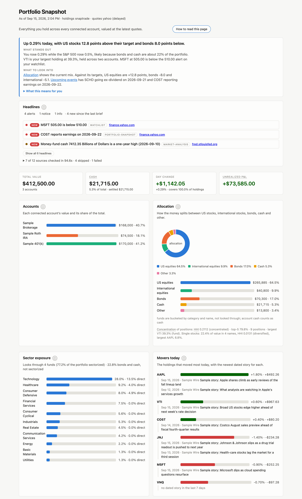
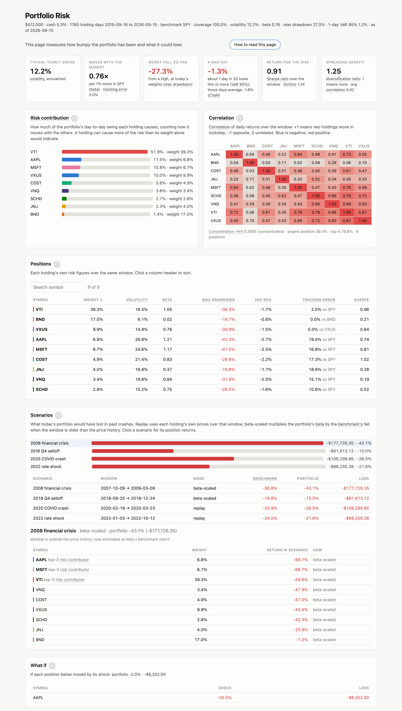
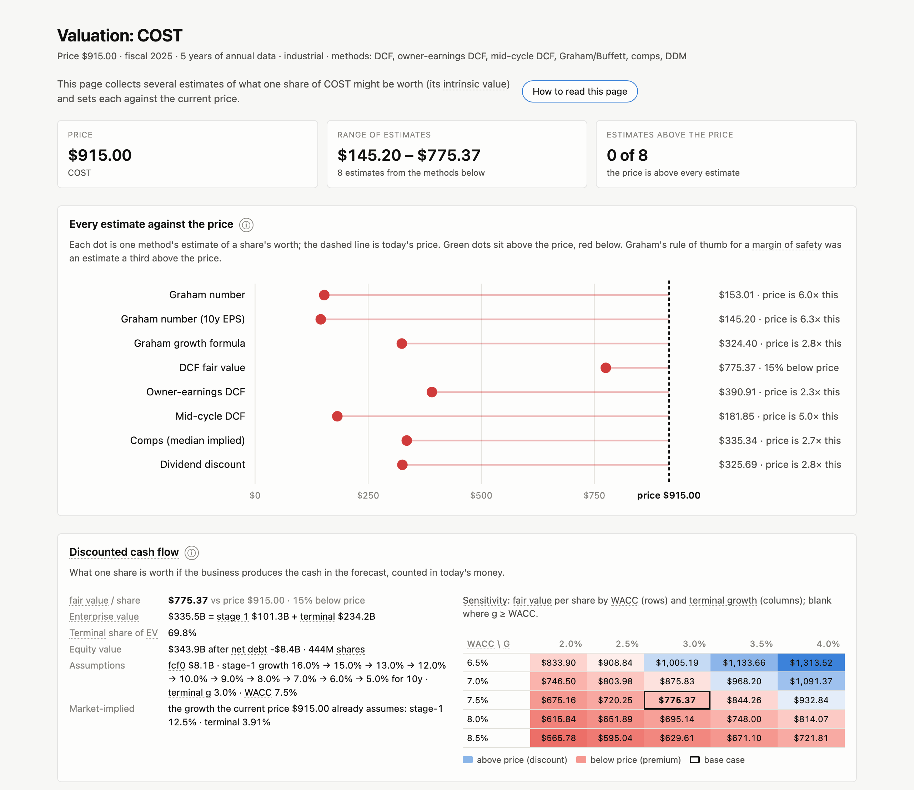
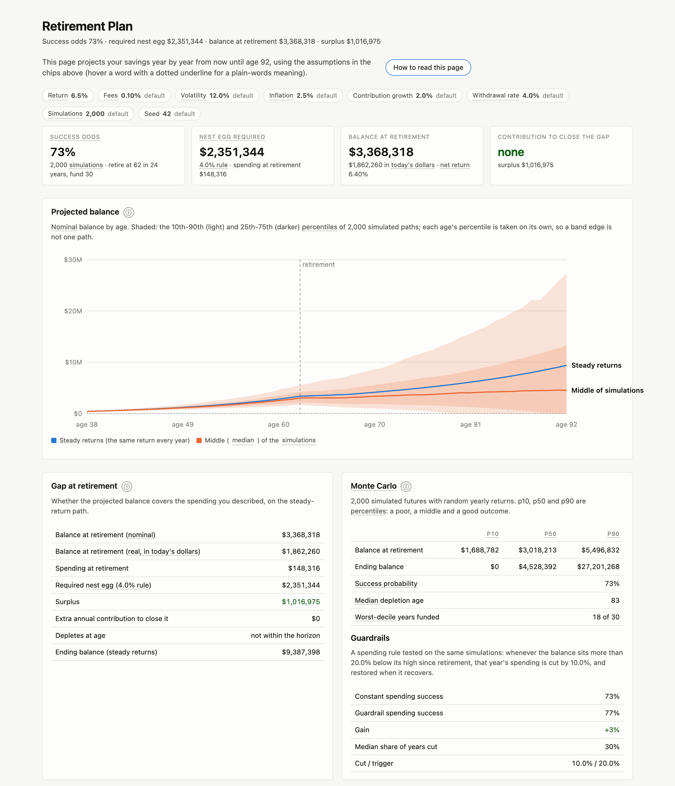
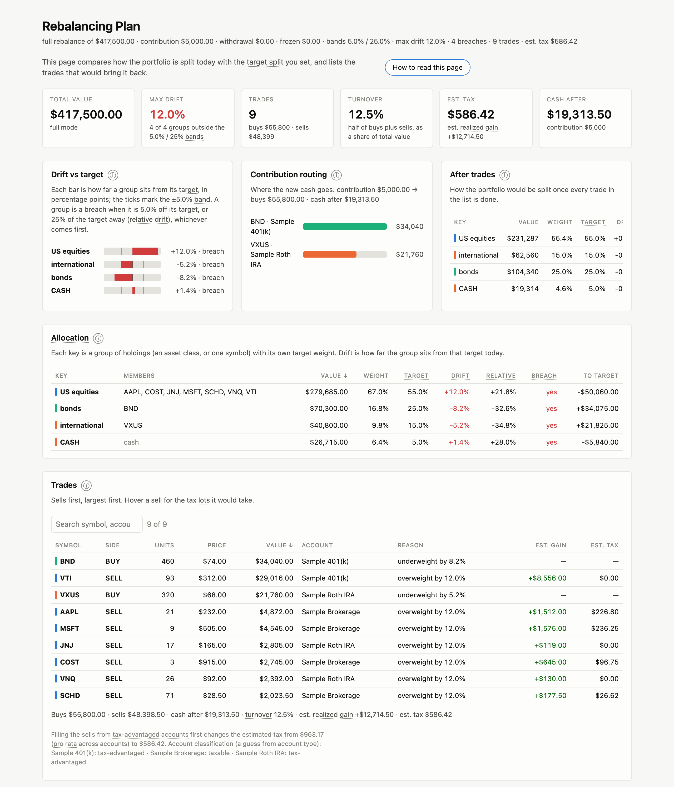
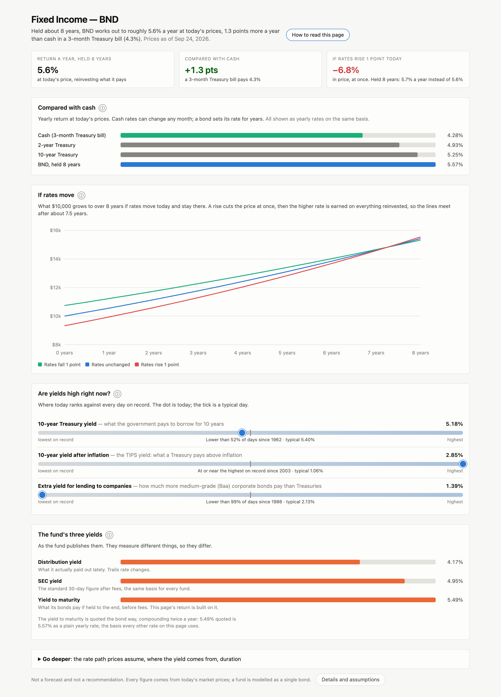
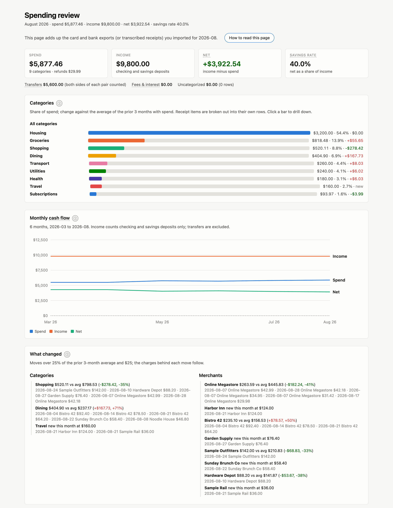

# Second Opinion | Personal Finance

**A principled second opinion on every money decision.**

[](LICENSE)
[](https://github.com/bshurick/second-opinion/actions/workflows/ci.yml)
[](https://claude.com/claude-code)

Second Opinion is a Claude Code plugin for your own finances. It reads the brokerage accounts you connect and the statements you give it, then works through questions about your portfolio, taxes, debt, home, and retirement. It lays out the numbers, the cases for and against, and the risks. It does not tell you to buy, sell, or hold.



> An independent open-source project, not affiliated with Anthropic, SnapTrade, E*Trade, or any brokerage or data provider. Nothing here is financial, tax, or legal advice; see [Safety and disclaimer](#safety-and-disclaimer).

## What you can ask

- "How is my portfolio doing today?"
- "What happens to my portfolio if 2008 repeats?"
- "What's a fair price for COST?"
- "I'm 38 with $400k saved. Am I on track to retire at 60?"
- "I'm moving. Run the numbers on selling my condo versus renting it out."
- "Buy 10 shares of VTI in my E*Trade account." Claude previews the order, and nothing is sent until you approve it.

More in [docs/examples.md](docs/examples.md).

## Install

You need [Claude Code](https://claude.com/claude-code) and Python 3.10+. In Claude Code:

```
/plugin marketplace add bshurick/second-opinion
/plugin install second-opinion@second-opinion
/reload-plugins
```

Then say **"get started with Second Opinion"**. One conversation walks you through setup a step at a time: adding keys, connecting a brokerage, and a few questions about how you invest. Every step can be skipped and picked up later.

**Brokerage keys are optional.** Research, planning, and learning work without one. To read your own accounts you need a free SnapTrade Personal API key or an E*Trade developer key ([how to get one](docs/connecting-brokerages.md)). Enter keys in your own terminal, never in the chat:

```bash
python3 ~/.claude/plugins/marketplaces/second-opinion/skills/get-started/scripts/configure.py keys
```

Add `--broker etrade` for an E*Trade key.

| To | Do this |
|---|---|
| Update | `claude plugin marketplace update second-opinion`, then `claude plugin update second-opinion@second-opinion`, then restart Claude Code |
| Change a setting | Say "show my settings" or "change a setting" |
| Uninstall | `/plugin uninstall second-opinion@second-opinion` |

Installing from a git checkout, scripted installs, and where settings live are covered in [docs/install.md](docs/install.md) and [docs/configuration.md](docs/configuration.md).

## How it works

- **Your whole picture.** Retirement, real estate, taxes, debt, and the portfolio are one problem. One session can price a rental, size the tax cost of funding it, and rerun the retirement projection.
- **Your actual holdings.** Account answers start from live positions and balances across every brokerage you connect.
- **Numbers from code.** Bundled Python scripts fetch the data and do the math (IRR, VaR, DCF, wash-sale matching, Monte Carlo). Claude runs them and explains the result. The model's own judgment comes in when it reads a statement PDF or receipt, builds scenarios in [deep research](#deep-research), or answers something the scripts do not cover.
- **Analysis, not advice.** The decision is yours. A model can still stray from its instructions, so treat what it says as analysis to check.
- **Local files.** Your keys and records stay in files on your machine. This project runs no server and has no account of its own. See [what leaves your machine](#what-leaves-your-machine).

Skills that produce a report publish an interactive page as a private Artifact on your claude.ai account, with sortable tables, charts, and light and dark themes. You can ask for the answer in chat instead.

<details>
<summary><b>Sample pages</b> (a made-up household, rendered from the fixtures in <a href="docs/samples">docs/samples</a>)</summary>

**Risk and stress test**: volatility, beta, drawdown, VaR, crash replays



**Valuation**: margin of safety by method, DCF with a growth sensitivity grid



**Retirement projection**: Monte Carlo success odds, nest egg required



**Rebalancing plan**: drift against bands, contribution routing, tax-aware trade list



**Fixed income**: what a bond fund earns if held, and what a rate move does



**Spending review**: category drill-down, monthly cash flow, what changed



</details>

## Skills

23 skills, all installed. You do not call them by name; ask a question and Claude picks the right one. **key** means a SnapTrade or E*Trade key. **EDGAR** means an SEC contact address in `EDGAR_USER_AGENT`.

| | Skill | What it does | Needs |
|---|---|---|---|
| **Setup** | get-started | First run, settings, extras, repairs | |
| **Accounts** | connect | Link or inspect brokerage connections | key |
| | portfolio-analysis | Daily brief, allocation, concentration, performance against a benchmark | key |
| | dividend-income | Projected income, yields, ex-dates, payer safety | key |
| | risk-analysis | Volatility, beta, drawdown, VaR, crash replays, what-if shocks | key |
| | watchlist | Price and drawdown alerts, checked when you ask or by cron | |
| **History** | statement-import | A local ledger from CSV exports or SnapTrade activity | key |
| | trade-review | Round trips, win rate, buy-and-hold counterfactuals | |
| | trade-journal | Thesis, target, and exit written down and checked before each buy | |
| | tax-aware | Realized gains, wash sales, open lots, estimated tax, harvesting | |
| | spending | Categories, recurring charges, and cash flow from card and bank exports | |
| **Planning** | portfolio-plan | Targets, drift, rebalancing, where a deposit goes, a sleeve for stock picks | key |
| | retirement | Monte Carlo projection, nest egg required, withdrawal rates | key |
| | real-estate | Mortgage, refinance, rent vs buy, rental underwriting, REIT metrics | |
| | personal-finance | Budgeting, cash flow, reminders, debts and payoff order | |
| **Research** | valuation | DCF, dividend discount, multiples, Graham and Buffett intrinsic value | deep mode: EDGAR |
| | fundamental-research | SEC financials, quality checklist, 10-K/10-Q reader, 13F holdings | EDGAR |
| | stock-screener | Seven screens over every US filer, and re-checks of saved picks | EDGAR |
| | options | Chains, implied volatility, expected move, greeks, payoffs | |
| | trading | Price action and technicals, plus order preview, placement, and cancellation | key |
| | market-analysis | Indices, sectors, yields, earnings calendar, market flows | |
| | fixed-income | What bonds earn held to your horizon, and the rate path prices imply | |
| **Learning** | financial-education | One concept at a time with worked numbers, sources, and quizzes | |

`trade-journal` is an extra that is on by default and adds a confirmation step to every buy. `financial-education` and suggested follow-up questions are extras you turn on. Every script behind the skills is listed in [docs/scripts.md](docs/scripts.md).

## Deep research

Six modes go beyond the scripted answers. Research subagents work through filings, primary sources, and the news, so a run takes minutes and uses much more of your Claude usage than an ordinary question.

| Mode | Ask | Subagents |
|---|---|---|
| Deep valuation | *"Do a deep dive on PHM: what has to go right?"* | 8 to 11 |
| Deep picker | *"Find me the best opportunities right now."* | 25 to 35 |
| Portfolio review | *"What single belief does my portfolio depend on most?"* | 8 |
| Property review | *"Run a deep review of 12 Main Street as a rental."* | 6 |
| Decision review | *"Which of my trades were skill and which were luck?"* | 10 |
| Tax plan comparison | *"Compare selling my stock awards over three years against a Roth conversion."* | 5 |

Scripts still do the math and every claim carries a source and date, but the scenarios are the model's judgment. Saved results can be re-checked later without rerunning the research ("how are my picks doing?"). Details, the deep picker's test, and re-checks are in [docs/deep-research.md](docs/deep-research.md).

## What leaves your machine

Keys sit in a `.env` you own and records are JSON files on your disk. These things do go out:

- **Data requests** to SnapTrade or E*Trade for your accounts, and to Yahoo Finance, SEC EDGAR, and FRED for market data.
- **Web searches** during deep research, run through Claude Code's own tools. Holding values, income, account names, and your name stay out of them.
- **The conversation with the model**, including the script results Claude reads. That is Anthropic's model by default, or an [open model through Ollama](docs/ollama.md), which can keep it local.
- **Report pages**, published as private Artifacts on your claude.ai account. Ask for the answer in chat if you do not want a page published.

## Safety and disclaimer

**Orders need your approval twice.**

1. Claude shows a preview of the order in chat and places nothing until you say yes in your own message. A yes covers only the orders in that preview.
2. A hook (`hooks/gate.sh`) then makes Claude Code ask you to approve the command itself. This applies to every order, cancellation, and brokerage disconnect, even when Claude Code would otherwise run commands without asking. In bypass-permissions mode those commands are blocked outright.

Read-only connections cannot trade, and if an order fails, the rest of the batch is not placed.

**Disclaimer.** This is an open-source personal project released under the [MIT License](LICENSE): provided as-is, with no warranty of any kind and no guarantee that it works correctly, completely, or at all. Nothing here is financial, investment, tax, or legal advice. By using it you accept that:

- **Orders are real.** With a trade-enabled connection, a confirmed order goes live to your brokerage. The only practice environments are SnapTrade's read-only `SANDBOX` brokerage and E*Trade's sandbox (`ETRADE_SANDBOX=1`), which use fake accounts.
- **The AI can be wrong.** A language model can misread a request, mix up a ticker, quantity, or side, misinterpret a preview, or act on stale or delayed data. The safeguards reduce this risk; they do not remove it. Read every preview yourself before approving.
- **Bugs happen.** This code, the SnapTrade SDK and service, E*Trade's API, Yahoo Finance data, and your brokerage can each fail or return wrong data, and those failures can cost money.
- **You are responsible.** The author and contributors accept no liability for any loss, damage, missed trade, unintended trade, tax consequence, account restriction, or anything else arising from use of this software, whether caused by the code, the model, the data, or the services it depends on.
- **Third-party terms apply.** Your use of SnapTrade, E*Trade, Yahoo Finance, SEC EDGAR, FRED, and your brokerage is governed by their terms, not this project's.

Sensible precautions: connect accounts read-only unless you need to trade, start with small orders, and check your brokerage's own order history after any trade. To report a security issue, see [SECURITY.md](SECURITY.md).

## Documentation

- [Installing](docs/install.md): marketplace, checkout, scripted, and manual installs
- [Connecting brokerages](docs/connecting-brokerages.md): SnapTrade, E*Trade, read-only and margin accounts
- [Configuration](docs/configuration.md): settings and environment variables
- [Example questions](docs/examples.md): what to ask each skill
- [Deep research](docs/deep-research.md): the six modes and their re-checks
- [Running on open models with Ollama](docs/ollama.md)
- [Running the scripts yourself](docs/running-scripts.md) and the [script reference](docs/scripts.md)
- [How skills are written](docs/skill-style.md)
- [Troubleshooting](docs/troubleshooting.md)

## Development

See [CONTRIBUTING.md](CONTRIBUTING.md). In short: create a virtualenv, `pip install -r requirements-dev.txt`, and run `python -m pytest tests -q`.

## License

MIT. See [LICENSE](LICENSE).
